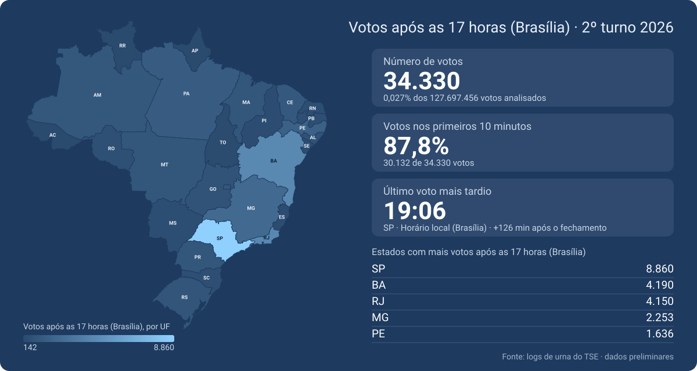

<div align="center">

# pos17


</div>

[](https://wsleyweber.github.io/pos17/)

**[Abrir o mapa interativo](https://wsleyweber.github.io/pos17/)**

> **Projeto independente, sem vínculo com o TSE. Dados preliminares.** Última atualização: `26/10/2026 23:41`. Cobertura: `497896` de `514464` seções.

Este projeto lê os **logs de urna** que o TSE publica e conta, por seção e por UF, quantos votos foram computados **depois das 17h (horário de Brasília)** e a que horas foi o último voto. Tudo vem de dados públicos, e o código para reproduzir o resultado está aqui.

## O que os números mostram (e o que não mostram)

- **Votos depois das 17h são esperados.** Segundo a imprensa, quem já está na fila no encerramento pode votar, e em 25/10/2026 o ministro Cristiano Zanin (STF) decidiu, pouco depois das 17h, que seções **ainda abertas** poderiam funcionar até as 19h (Brasília), a pedido das campanhas. Seções já encerradas não foram reabertas. O log da urna não diz se uma seção estava com fila ou funcionando por causa dessa decisão. ([Gazeta do Povo](https://www.gazetadopovo.com.br/eleicoes/2026/extensao-horario-votacao-teve-35-mil-votos-17h-19h/), [CNN Brasil](https://www.cnnbrasil.com.br/eleicoes/votos-registrados-apos-17h-foram-0027-do-total-computado-no-2-turno/); confirme na decisão original antes de citar.)
- **O projeto não diz em quem os votos foram dados.** O registro digital do voto (RDV) embaralha a ordem e não tem horário, então não há como ligar horário a candidato.
- **Este mapa não indica irregularidade.** Ele mostra volume e horário. Estados com poucas seções ou poucos votos oscilam muito por acaso, então compare com cuidado.
- Para conferir a ordem de grandeza, análises da imprensa a partir dos mesmos logs (CNN Brasil com a setup.news, G1) chegaram a cerca de 34 a 35 mil votos depois das 17h no país, com cobertura quase completa das seções. Os totais deste projeto só são comparáveis quando a cobertura for equivalente.

## Metodologia

1. **Fonte.** Para cada seção, o coletor lê o `aux.json` (que traz o *hash* e os nomes dos arquivos), baixa o `-log.jez` (um ZIP) e lê o `logd.dat`.
2. **Voto.** Cada linha `O voto do eleitor foi computado` do dia 25/10/2026 conta como um voto, com o horário da própria linha.
3. **Horário.** É o **relógio local da urna**, sem conversão de fuso.
4. **Corte.** 17h de Brasília, convertido para o relógio local **de cada município**: **15h no Acre**, **16h em AM, RO, RR, MT e MS**, 17h nos demais estados. O fuso de cada município é deduzido dos próprios logs (mediana do horário do primeiro voto, com pelo menos 3 seções; a votação abre às 8h de Brasília). Isso pega o oeste do Amazonas (15h) e Fernando de Noronha (18h) sem lista manual; os municípios que divergem do padrão da UF ficam em `dados/fusos_inferidos.csv`. Votos com horário igual ou posterior ao corte contam como "após as 17h (Brasília)".
5. **Faixas de 10 minutos.** O coletor guarda a contagem por faixa de 10 minutos, a partir das 14h locais, e os totais completos (votos e votos sem biometria) em colunas próprias da seção. Os percentuais usam sempre os totais completos como denominador. "Primeiros 10 minutos" é o intervalo do corte até 10 minutos depois.
6. **Último voto do estado.** É o maior horário entre as seções do estado. O painel mostra também o horário até o qual 99% das seções terminaram, porque uma única urna com relógio errado pode puxar o máximo.
7. **Cobertura.** Seções sem log ou com erro ficam fora das contas e aparecem na contagem de cobertura.
8. **Acesso aos arquivos.** O coletor respeita os limites que o TSE informa (até 100 requisições por segundo por IP; usa 40 por padrão) e pausa os downloads se o servidor bloquear o acesso.

## Limitações conhecidas

- Os dados são **preliminares**: o TSE ainda pode publicar logs de seções que faltam.
- O texto das linhas de log usadas para identificar o voto foi conferido com logs reais, mas pode mudar entre eleições ou versões da urna.
- Municípios com menos de 3 seções com log usam o fuso padrão da UF. Se algum deles tiver outro fuso, o corte dele fica errado em 1 hora.
- Urnas substituídas ou com relógio desajustado podem distorcer o horário do último voto de uma seção.
- Não há, por ora, comparação com o comparecimento oficial por município nem com o boletim de urna.

Encontrou um erro? Abra uma *issue*. Correções serão publicadas com a data e o que mudou.

## Dados

Os resumos ficam em [`dados/`](dados/):

| Arquivo | Conteúdo |
|---|---|
| `resumo_uf.csv` | Votos totais e após as 17h (Brasília), por UF |
| `horarios_uf.csv` | Horário do último voto, % nos primeiros 10 e 30 minutos, por UF |
| `resumo_geral.json` | Totais nacionais e cobertura de seções |

O banco com uma linha por seção (`logs_urna.sqlite`) não está versionado por ser grande. Ele pode ser gerado de novo com o coletor.

## Como reproduzir

Requer Python 3.10+.

```bash
pip install -r requirements.txt

# 1. Coletar (por UF, para testar; depois use --todas). O coletor retoma de onde parou.
python src/coletor_tse.py --ufs rr
python src/coletor_tse.py --todas

# 2. Recalcular os resumos e gerar o mapa
python atualizar.py
```

Se o coletor falhar na primeira seção, confira os modelos de endereço (`URL_*`) e os padrões de linha do log (`RE_*`) no topo de `src/coletor_tse.py`. A opção `--calibrar arquivo.jez` mostra os tipos de linha de um log real. Use `--taxa` para reduzir a velocidade, se necessário.

## Estrutura

```
.
├── README.md
├── LICENSE
├── atualizar.py        recalcula os resumos e regera o mapa
├── requirements.txt
├── src/
│   ├── coletor_tse.py  baixa os logs e grava logs_urna.sqlite
│   ├── resumo.py       totais por UF e nacional
│   ├── horarios.py     horário do último voto e distribuição após as 17h
│   ├── gerar_mapa.py   gera docs/index.html e docs/mapa.svg
│   └── brasil_ufs.json malha simplificada dos estados
├── dados/              resumos em CSV/JSON (versionados)
└── docs/               site publicado no GitHub Pages
```

## Fontes

Arquivos públicos do TSE, referentes ao 2º turno de 2026:

- Lista de seções: `https://resultados.tse.jus.br/oficial/ele2026/arquivo-urna/3221/config/`
- Arquivos de cada seção: `https://resultados.tse.jus.br/oficial/ele2026/arquivo-urna/3221/dados/`
- Comparecimento e abstenção por município: `https://resultados.tse.jus.br/oficial/ele2026/6258/dados/`
- Regras de acesso: [Informações técnicas sobre a divulgação de resultados (TSE)](https://www.tse.jus.br/eleicoes/informacoes-tecnicas-sobre-a-divulgacao-de-resultados)
- Malha dos estados: dados abertos de geometria dos estados brasileiros, simplificados para este mapa.